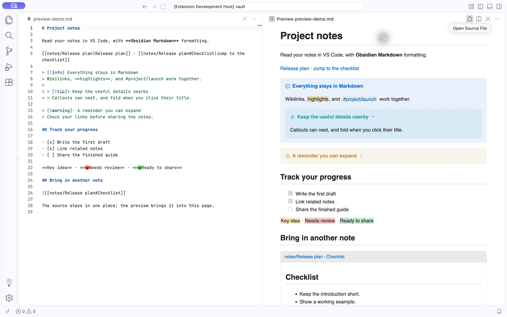
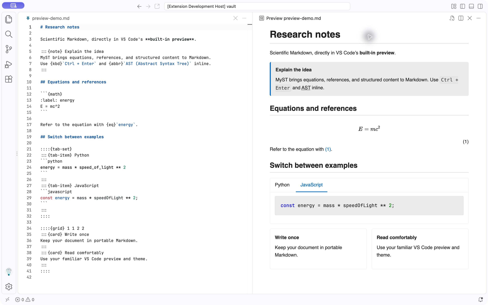

# Markdown Chroma

Read **Obsidian Markdown and MyST / Jupyter Book 2** in VS Code's built-in Markdown Preview. Follow links between notes, bring related content into a page, and preview equations, callouts, tabs, and scientific documents while you write.

Start with any folder of Markdown files. An Obsidian vault or MyST project is optional, and the extension needs no separate Node.js installation or document server.

## Start reading in three steps

1. Install the Markdown Chroma `.vsix` with **Extensions: Install from VSIX...** in VS Code.
2. Open a folder of Markdown files, then open a `.md` document.
3. Run **Markdown: Open Preview to the Side** from the Command Palette.

Shortcut: **Cmd+K V** on macOS or **Ctrl+K V** on Windows/Linux. You can also run **Markdown Chroma: Open Preview to the Side**.

The preview follows your VS Code theme and scroll position. Open-document edits appear before you save, including edits to notes embedded in the page. Add a language such as `python`, `javascript`, or `json` after the opening code fence for syntax highlighting.

## Your notes, with Obsidian Markdown

Wikilinks, note embeds, foldable callouts, highlights, tags, tasks, and footnotes work together in the same preview.



[Open the screenshot example](examples/vault/preview-demo.md), or explore the [full Obsidian showcase](examples/vault/Showcase.md) with images, audio, tables, and nested embeds.

Try a link and a callout in your own note:

```markdown
[[Release plan|Read the release plan]]

> [!tip]+ Keep the context nearby
> Use ==highlights== and link to [[Related notes]].

![[Release plan#Checklist]]
```

Links can use a file name, heading, block ID, or frontmatter alias. Put note embeds on their own line. Click a callout title to fold it; keyboard navigation works too.

## Scientific writing, with MyST

Preview equations and references, admonitions, figures, citations, glossaries, tabs, cards, proofs, and exercises directly in Markdown. A `myst.yml` file can supply project settings, but you can start without one.



[Open the screenshot example](examples/myst/preview-demo.md). More examples cover [scientific documents](examples/myst/index.md), [layouts and figures](examples/myst/layout.md), [syntax](examples/myst/syntax.md), and [glossaries and terms](examples/myst/glossary.md).

For example, give an equation a label and refer to it later:

````markdown
```{math}
:label: energy
E = mc^2
```

See equation {eq}`energy`.
````

See the [MyST authoring guide](https://mystmd.org/guide) for the syntax.

## Make the preview yours

Use VS Code's normal Markdown preview settings and your preferred theme. For a deeper look at links, media, callout colors and icons, frontmatter, and MyST options, see the [preview guide](docs/PREVIEW.md).

| Setting | Default | Use it to |
| --- | --- | --- |
| `obsidianMarkdown.maxEmbedDepth` | `5` | Limit how deeply notes can embed other notes |
| `markdown.preview.frontMatter` | `"table"` | Show frontmatter as a table, code block, or hide it |
| `markdown.preview.breaks` | `false` | Display single line breaks in the preview |

## CLI and MCP guides

- [CLI: installation, search, section reads, and automatic indexing](docs/CLI.md)
- [MCP server: VS Code setup, stdio and URL connections, tools, and shared API](docs/MCP.md)

## What to expect

Markdown Chroma enhances the **reading preview** on desktop VS Code. Checkboxes are read-only. Document code, Dataview, Templater, and Obsidian plugins are not executed, and Obsidian themes are not loaded automatically. MyST previews display local includes and saved notebook outputs without running a notebook or publishing a book.

Local files are supported; virtual workspaces and browser-based VS Code are not. Missing or ambiguous note links show an explanation, and cyclic embeds stop safely. For additional limits and syntax details, see the [preview guide](docs/PREVIEW.md).

## Help and contributions

Report a problem or suggest a feature in [GitHub Issues](https://github.com/studykit/vscode-markdown-chroma/issues). Include a small Markdown example and your VS Code version so the behavior can be reproduced.

Developer setup, build instructions, and verification are in [AGENTS.md](AGENTS.md). Released under the [MIT license](LICENSE).
